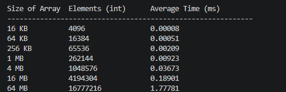
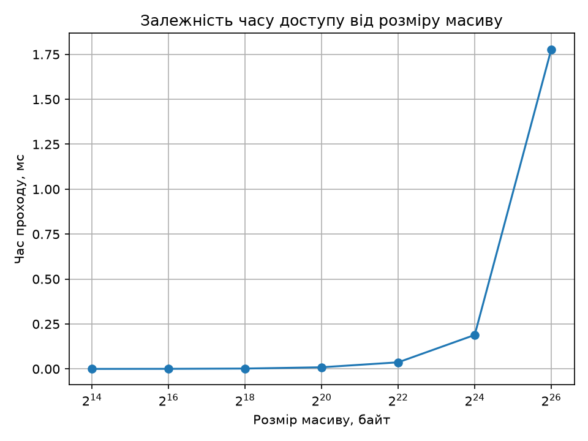

# Самостійна робота №5
## Студент: Матвійчук Роман
## Група: ІПЗ-4/2
## Тема: Вимірювання впливу кешу: експеримент програмою
## Варіант: 8 (Мова C++, обхід масиву int з кроком 16 елементів)

### 1. Код програми вимірювання (C++)

Згідно з варіантом 8, програму написано мовою C++. Масив типу int обходиться з кроком 16 елементів. Якщо розмір int становить 4 байти, такий крок відповідає 64 байтам, що зазвичай дорівнює розміру одного рядка кешу.

[Переглянути код practic4.asm](main.cpp)

### 2. Таблиця вимірювань часу доступу

Після запуску програми мовою C++ було отримано такі результати вимірювання часу обходу масивів різного розміру з кроком 16 елементів.



### 3. Графік залежності часу доступу від розміру робочого набору


Зі збільшенням розміру масиву середній час проходу зростає. Найбільше збільшення спостерігається між 16 МБ і 64 МБ. Це може бути пов'язано з перевищенням доступного обсягу кеш-пам'яті та збільшенням кількості звернень до оперативної пам'яті.

### 4. Визначення орієнтовної межі кешу

На графіку найбільш помітний східчастий злам спостерігається під час переходу від робочого набору розміром 16 МБ до 64 МБ. Тому орієнтовна межа кешу знаходиться між 16 МБ і 64 МБ. Середня оцінка цієї межі становить приблизно 32 МБ:

```text
√(16 МБ × 64 МБ) ≈ 32 МБ
```

За даними про процесор, обсяг кешу становить:

| Рівень кешу | Розмір |
|---|---:|
| L1 | 384 КБ |
| L2 | 3,0 МБ |
| L3 | 32,0 МБ |

Отримана за графіком оцінка приблизно 32 МБ найкраще відповідає кешу третього рівня L3. Отже, східчастий злам, найімовірніше, пов'язаний із перевищенням кешу L3 та переходом до повільнішої оперативної пам'яті. Межі кешів L1 і L2 за цим експериментом визначити менш точно, оскільки вимірювання проводилися для обмеженого набору розмірів масиву.

## Висновок

У ході самостійної роботи було розроблено програму мовою C++ для вимірювання часу обходу масивів різного розміру з кроком 16 елементів. Було розглянуто вплив кеш-пам'яті різних рівнів на швидкість доступу до даних.

Збільшення розміру масиву може призводити до зростання часу виконання через перевищення місткості кешу L1, L2 та L3. Якщо робочий набір не вміщується в кеші, процесору доводиться частіше звертатися до повільніших рівнів пам'яті.

Для підтвердження цих залежностей необхідно порівняти фактичні результати вимірювань із характеристиками тестового процесора.