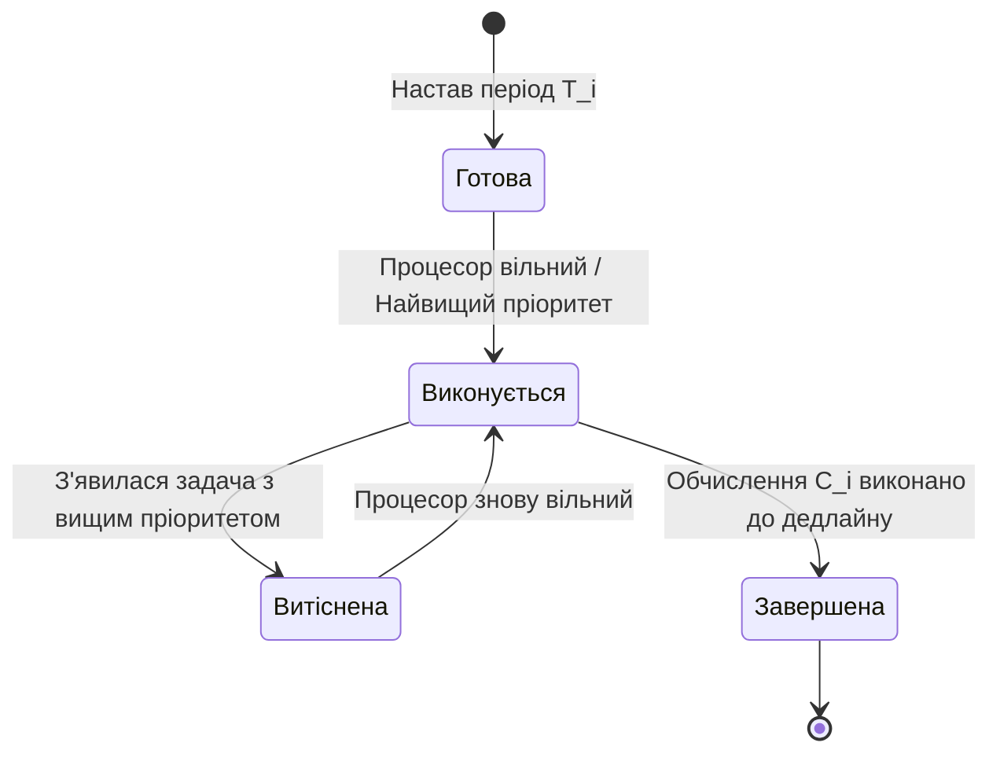

# Самостійна робота №9
## Студент: Матвійчук Роман
## Група: ІПЗ-4/2
## Тема: Системи реального часу і RTOS  
## Варіант: 8 

## 1. Розрахунок коефіцієнта завантаження процесора

Коефіцієнт завантаження процесора показує, яку частину процесорного часу займає виконання всіх періодичних задач.

Для його розрахунку використовується формула:

U = C1/T1 + C2/T2 + C3/T3 + C4/T4

Підставимо вихідні дані:

U = 4/18 + 8/36 + 15/72 + 40/180.

Обчислимо кожен доданок:

- Задача 1: 4/18 = 0,2222.
- Задача 2: 8/36 = 0,2222.
- Задача 3: 15/72 = 0,2083.
- Задача 4: 40/180 = 0,2222.

Знайдемо суму:

U = 0,2222 + 0,2222 + 0,2083 + 0,2222.

U = 0,875.

Переведемо результат у відсотки:

0,875 * 100% = 87,5%.

Відповідь: коефіцієнт завантаження процесора становить 0,875, або 87,5%.

Отже, на виконання задач використовується приблизно 87,5% процесорного часу. Решта 12,5% припадає на вільний процесорний час у середньому за повний цикл планування.

## 2. Аналіз умови планованості

Для виконання задач у системах реального часу важливо, щоб кожна задача завершувалася до свого дедлайну.

Умова завантаження процесора має вигляд:

U <= 1.

У нашому випадку:

0,875 <= 1.

Отже, процесор не перевантажений за сумарним обсягом обчислень.

Проте для алгоритму Rate Monotonic умова U <= 1 сама по собі не гарантує планованість за фіксованих пріоритетів. Тому необхідно перевірити часовий розклад виконання задач та переконатися, що вони завершуються до відповідних дедлайнів.

Для цього побудуємо часову діаграму на інтервалі від 0 до 180 мс.

## 3. Призначення пріоритетів за алгоритмом Rate Monotonic (RM)

Rate Monotonic (RM) - це алгоритм планування задач реального часу з фіксованими пріоритетами. Чим коротший період задачі, тим вищий пріоритет їй призначається.

Відповідно до заданих періодів пріоритети розподіляються так:

| Пріоритет | Задача | Період | Час виконання |
|---|---|---:|---:|
| 1 - найвищий | Задача 1 | 18 мс | 4 мс |
| 2 | Задача 2 | 36 мс | 8 мс |
| 3 | Задача 3 | 72 мс | 15 мс |
| 4 - найнижчий | Задача 4 | 180 мс | 40 мс |

Задача 1 має найвищий пріоритет, оскільки її період найкоротший. Задача 4 має найнижчий пріоритет, оскільки її період найдовший.

Якщо під час виконання задачі з нижчим пріоритетом з'являється готова до виконання задача з вищим пріоритетом, поточна задача витісняється. Після завершення задач із вищими пріоритетами вона продовжує виконання з того місця, де була перервана.

## 4. Часова діаграма виконання задач на інтервалі від 0 до 180 мс

```mermaid
gantt
    title Часова діаграма виконання задач Rate Monotonic (Варіант 8)
    dateFormat X
    axisFormat %s мс

    section Задача 1 (T=18, C=4)
    P1_1   :active, t1_1, 0, 4
    P1_2   :active, t1_2, 18, 22
    P1_3   :active, t1_3, 36, 40
    P1_4   :active, t1_4, 54, 58
    P1_5   :active, t1_5, 72, 76
    P1_6   :active, t1_6, 90, 94
    P1_7   :active, t1_7, 108, 112
    P1_8   :active, t1_8, 126, 130
    P1_9   :active, t1_9, 144, 148
    P1_10  :active, t1_10, 162, 166

    section Задача 2 (T=36, C=8)
    P2_1   :crit, t2_1, 4, 12
    P2_2   :crit, t2_2, 40, 48
    P2_3   :crit, t2_3, 76, 84
    P2_4   :crit, t2_4, 112, 120
    P2_5   :crit, t2_5, 148, 156

    section Задача 3 (T=72, C=15)
    P3_1a  :done, t3_1a, 12, 18
    P3_1b  :done, t3_1b, 22, 31
    P3_2a  :done, t3_2a, 84, 90
    P3_2b  :done, t3_2b, 94, 103
    P3_3a  :done, t3_3a, 156, 162
    P3_3b  :done, t3_3b, 166, 175

    section Задача 4 (T=180, C=40)
    P4_part1 :milestone, t4_1, 31, 36
    P4_part2 :milestone, t4_2, 48, 54
    P4_part3 :milestone, t4_3, 58, 72
    P4_part4 :milestone, t4_4, 103, 108
    P4_part5 :milestone, t4_5, 120, 126
    P4_part6 :milestone, t4_6, 130, 134
```

#### Схема станів задач у RTOS:

### 5. Аналіз дедлайнів та висновки

- **Перевірка виконання дедлайнів:** За наведеною часовою діаграмою всі задачі завершують свої обчислення до відповідних дедлайнів Di = Ti на інтервалі від 0 до 180 мс.

- **Запас часу:** Задача 4 (найнижчий пріоритет) завершує виконання на моменті t = 134 мс. До її дедлайну D4 = 180 мс залишається 46 мс.

- **Простій ЦП (Idle):** Процесор перебуває в режимі простою на інтервалах [134; 144) мс та [175; 180) мс.

- **Рекомендації щодо надійності:** Для підвищення ефективності системи можна розглянути оптимізацію обчислень задачі 4 або поділ її обчислень на менші частини, якщо це допускає логіка програми. Використання DMA або GPU доцільне лише тоді, коли характер обчислень відповідає можливостям цих пристроїв.

## Висновок

ід час виконання самостійної роботи було розглянуто принципи планування задач у системах реального часу та застосовано алгоритм Rate Monotonic для чотирьох періодичних задач.

Сумарний коефіцієнт завантаження процесора становить 0,875, або 87,5%. Це означає, що задачі потребують 87,5% процесорного часу в середньому за повний цикл планування.

Відповідно до алгоритму RM найвищий пріоритет отримала задача 1 з періодом 18 мс, а найнижчий — задача 4 з періодом 180 мс.

За побудованою часовою діаграмою на інтервалі від 0 до 180 мс усі задачі завершуються до своїх дедлайнів. Задача 4 завершує виконання на 134-й мілісекунді, маючи запас часу 46 мс до свого дедлайну.

Отже, побудований розклад підтверджує виконання часових обмежень на розглянутому інтервалі. Для підвищення ефективності системи доцільно оптимізувати обчислення та надалі перевіряти планованість задач з урахуванням їхніх періодів, часу виконання і пріоритетів.