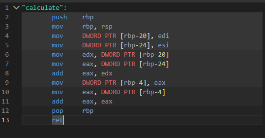
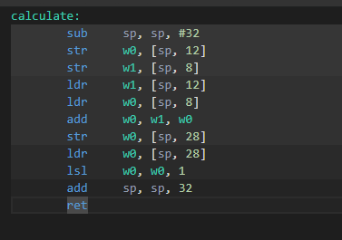
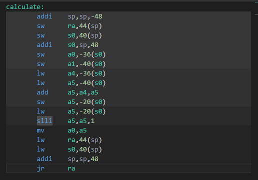

# Самостійна робота №5
## Студент: Матвійчук Роман
## Група: ІПЗ-4/2
## Тема: Порівняння систем команд х86, ARM, RISC-V
## Варіант: 8 

### 1. Код мовою С та асемблерний вивід компілятора (прапорець -O0)

```c
double average(const double* arr, int n) {
    double sum = 0.0;
    for (int i = 0; i < n; i++) {
        sum += arr[i];
    }
    return sum / n;
}
```
#### Асемблерний код x86-64 (System V AMD64 ABI):

#### Асемблерний код ARM64:

#### Асемблерний код RISC-V:


### 2. Кількість асемблерних інструкцій

Під час підрахунку враховано всі рядки з командами в тілі функції, включно з інструкціями повернення (`ret` або `jr`). Мітка `calculate:` не є інструкцією, тому не враховується.

| Архітектура | Кількість інструкцій |
|---|---:|
| x86-64 | 12 |
| ARM64 | 12 |
| RISC-V | 17 |

Найменше інструкцій використано у варіантах x86-64 та ARM64 по 12. У наведеному варіанті RISC-V функція містить 17 інструкцій.

### 3. Регістри передавання аргументів і результату

Для функції `average(const double* arr, int n)` перший аргумент є вказівником на масив, другий — цілим числом `n`, а результат має тип `double`.

| Архітектура | Регістри аргументів | Регістр результату |
|---|---|---|
| x86-64 (System V AMD64 ABI) | `RDI` - `arr`, `ESI` - `n` | `XMM0` |
| ARM64 (AArch64 ABI) | `X0` - `arr`, `W1` - `n` | `D0` |
| RISC-V (LP64D ABI) | `a0` - `arr`, `a1` - `n` | `fa0` |

У x86-64 значення з плаваючою крапкою повертається через регістр `XMM0`, в ARM64 - через `D0`, а в RISC-V із підтримкою розширення `D` - через `fa0`.

## Висновок

Під час компіляції функції обчислення середнього арифметичного масиву без оптимізацій (`-O0`) наочно проявляються архітектурні відмінності. CISC-архітектура x86-64 згенерувала 25 інструкцій завдяки складним режимам адресації. RISC-архітектури (ARM64: 24 інструкції, RISC-V: 29 інструкцій) суворо дотримуються принципу Load/Store: будь-які математичні операції з числами з рухомою комою (`fadd.d`, `fdiv.d`) виконуються виключно над плаваючими регістрами. Для додавання елемента масиву RISC-V змушений окремо обчислити зсув адреси (`slli`), завантажити її з пам'яті (`ld`, `fld`) і лише потім виконати додавання. У x86-64 частина адресних розрахунків реалізується безпосередньо в межах однієї інструкції, що зменшує загальну кількість команд у коді.
