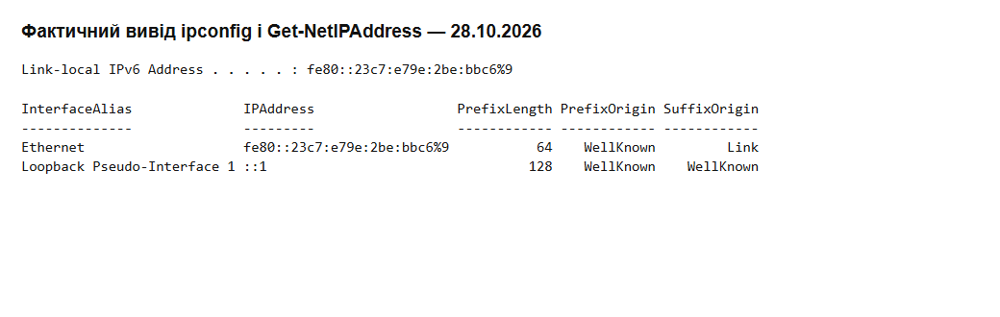

# Самостійна робота №11
## Студент: Матвійчук Роман
## Група: ІПЗ-4/2
## Тема: IPv6: адресація і механізми переходу
## Варіант: 8

### 1. Скорочення IPv6-адреси

Початкова адреса: `fe80:0000:0000:0000:0204:61ff:fe9d:f156`.

Прибираю провідні нулі: `fe80:0:0:0:204:61ff:fe9d:f156`. Три сусідні нульові групи замінюю на `::`. Результат: **`fe80::204:61ff:fe9d:f156`**.

### 2. Визначення типу адреси

Це **link-local unicast**. Перший блок `fe80` у двійковому вигляді — `1111 1110 1000 0000`; перші 10 бітів `1111111010` відповідають префіксу **`fe80::/10`**. Такі адреси діють у межах одного каналу й не пересилаються маршрутизаторами на інші канали. Джерело: [RFC 4291, §2.5.6](https://www.rfc-editor.org/rfc/rfc4291.html#section-2.5.6).

### 3. Поділ префікса на 16 підмереж

Задано `2001:0db8:def0:0034::/64`. Оскільки **16 = 2⁴**, додаю 4 біти: **/64 + 4 = /68**. Номер підмережі займає старшу шістнадцяткову цифру п'ятого блока; крок становить `1000₁₆` у цьому блоці.

| Підмережа | Номер у 4 бітах | Префікс |
|---|---|---|
| Перша | 0000 | `2001:db8:def0:34::/68` |
| Друга | 0001 | `2001:db8:def0:34:1000::/68` |
| Третя | 0010 | `2001:db8:def0:34:2000::/68` |
| Остання, шістнадцята | 1111 | `2001:db8:def0:34:f000::/68` |

У кожній підмережі **2⁶⁰ адрес**; 16 × 2⁶⁰ = 2⁶⁴, тобто весь початковий блок. Це арифметичний поділ: для звичайної SLAAC-мережі Ethernet потрібен /64, тому /68 не підходить для такого автоматичного налаштування. Префікс `2001:db8::/32` призначений для документації.

### 4. Власна IPv6-адреса

Команди `ipconfig /all` і `Get-NetIPAddress -AddressFamily IPv6` на адаптері **Ethernet** показали **`fe80::23c7:e79e:2be:bbc6%9/64`**: `PrefixOrigin = WellKnown`, `SuffixOrigin = Link`. Позначка `%9` — індекс інтерфейсу. Це link-local адреса; ймовірний механізм отримання — локальне автоматичне формування за процедурою SLAAC, а не DHCPv6. Це не підтверджує отримання глобального префікса через оголошення маршрутизатора. Глобальної або ULA-адреси на адаптері не виявлено ([автоналаштування, RFC 4862](https://www.rfc-editor.org/rfc/rfc4862.html#section-5.3)).

#### Контрольні запитання

1. **Скільки разів можна використати `::`:** один, інакше незрозуміло, як розподілити пропущені нульові групи.
2. **Префікси:** link-local — `fe80::/10`, multicast — `ff00::/8`.
3. **ULA і глобальна адреса:** ULA з `fc00::/7` призначені для внутрішніх мереж, глобальні unicast — для глобальної адресації та маршрутизації.
4. **Заголовок IPv6:** фіксовані 40 байтів, додаткові параметри винесено в заголовки розширення; контрольну суму прибрано, щоб не перераховувати її на кожному маршрутизаторі, враховуючи перевірки на інших рівнях.
