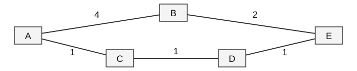

# Самостійна робота №12
## Студент: Матвійчук Роман
## Група: ІПЗ-4/2
## Тема: Порівняння протоколів маршрутизації RIP, OSPF, BGP
## Варіант: 8 (джерело A, призначення E)

### 1. Шлях за кількістю переходів

Граф неорієнтований. Ребра: **A–B(4), B–E(2), A–C(1), C–D(1), D–E(1)**. Якщо кожне ребро рахувати за один перехід, найкоротший маршрут — **A → B → E, 2 переходи**. Інший простий маршрут A → C → D → E має 3 переходи.

### 2. Шлях за сумою ваг: алгоритм Дейкстри

Початково d(A) = 0, решта відстаней — ∞. На кожному кроці обираю необроблений вузол із найменшою відстанню та перевіряю його сусідів: d(v) = min(d(v), d(u) + w(u,v)).

| Крок | Оброблено | d(A) | d(B) | d(C) | d(D) | d(E) |
|---|---|---:|---:|---:|---:|---:|
| 0 | — | 0 | ∞ | ∞ | ∞ | ∞ |
| 1 | A | 0 | 4 | 1 | ∞ | ∞ |
| 2 | C | 0 | 4 | 1 | 2 | ∞ |
| 3 | D | 0 | 4 | 1 | 2 | 3 |
| 4 | E | 0 | 4 | 1 | 2 | 3 |
| 5 | B | 0 | 4 | 1 | 2 | 3 |

На кроці E шлях до B через E коштує 3 + 2 = 5, тому відстань 4 не змінюється. Попередники для E: E ← D ← C ← A. Отже, **A → C → D → E**, вартість **1 + 1 + 1 = 3**.

### 3. Порівняння маршрутів

Шляхи розходяться вже у вузлі **A**: за переходами обирається B, а за сумою ваг — C. Маршрут A–B–E коротший за кількістю ребер, але його вартість дорівнює **4 + 2 = 6**, удвічі більше за 3. Підрахунок переходів вважає всі канали однаковими й не враховує їхніх ваг. Якби всі ребра мали однакову додатну вагу, мінімуми за обома критеріями завжди збігалися б, хоча рівноцінних шляхів могло б бути кілька.

### 4. Порівняння RIP, OSPF і BGP

| Протокол | Тип алгоритму | Метрика / вибір | Область | Збіжність | Масштабованість |
|---|---|---|---|---|---|
| RIP | Дистанційно-векторний, Беллман–Форд | Переходи: до 15; 16 — недосяжність | Невеликі мережі всередині AS | Порівняно повільна | Низька |
| OSPF | Стан каналу, Дейкстра | Сума вартостей каналів | Усередині AS, поділ на області | Зазвичай швидка | Висока в межах AS |
| BGP | Вектор шляху | Політики й атрибути, зокрема LOCAL_PREF та AS_PATH | Між AS; iBGP поширює маршрути всередині AS | Часто повільніша, залежить від політик і таймерів | Глобальний масштаб |

BGP потрібний через великий обсяг міжавтономної таблиці: він працює з префіксами та підтримує агрегацію маршрутів. Усім провайдерам не потрібно знати повну внутрішню топологію одне одного. Друга причина — договірні відносини: **peering** означає узгоджений обмін трафіком, а **transit** — послугу доступу до інших мереж. Тому вибір маршруту враховує політики й домовленості, а не лише технічну відстань.

#### Контрольні запитання

1. **Різні маршрути:** протоколи можуть використовувати різні метрики; тут це 2 переходи проти вартості 3.
2. **Крок Дейкстри:** обрати найближчий необроблений вузол і перевірити, чи скоротиться через нього шлях до сусідів.
3. **OSPF / BGP:** OSPF знаходить маршрути всередині AS, BGP обмінюється досяжністю префіксів між AS.
4. **Чому не лише відстань:** провайдери також враховують політики, оплату транзиту й умови обміну трафіком.
