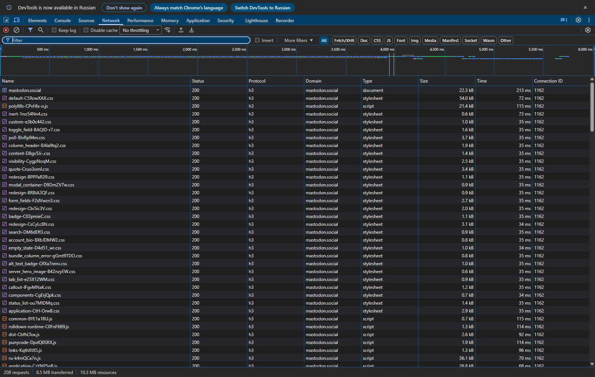
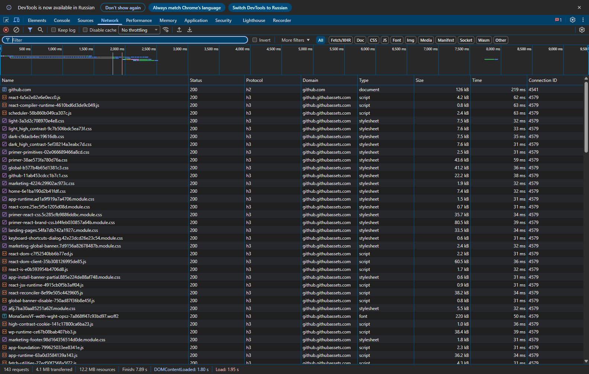

# Самостійна робота №13
## Студент: Матвійчук Роман
## Група: ІПЗ-4/2
## Тема: HTTP/2, HTTP/3 і QUIC
## Варіант: 8 (соціальна мережа; сайт розробника)

### 1. Спостереження у вкладці Network

28.10.2026 відкрив головні сторінки [Mastodon.social](https://mastodon.social/) і [GitHub](https://github.com/) у Chrome та ввімкнув колонки **Protocol**, **Domain**, **Connection ID**. Спостерігав приблизно 15 секунд після відкриття кожної сторінки, без входу в обліковий запис; HTTP-кеш було вимкнено через інструменти браузера. Mastodon перенаправив на `/explore`. Профіль браузера вже мав відомості про підтримку HTTP/3 цими сайтами.

| Сайт | Версія протоколу | З'єднань до основного хоста | Кількість ресурсів / запитів |
|---|---|---:|---:|
| Mastodon.social — соціальна мережа | `h3` для документа та ресурсів | 2 | 208 |
| GitHub — сайт розробника | `h2` для головного документа; `h3` для ресурсів CDN | 1 | 143 |

Кількість ресурсів наведено за лічильником **requests** у Network: він включає документ, запити API, службові й незавершені запити. З'єднання рахував за різними непорожніми **Connection ID саме основного хоста**, а не всіх доменів сторінки. Для `mastodon.social` зафіксовано ID **1162** і **2412**, для `github.com` — **4541**. Це результат конкретного завантаження: під час повторного відкриття кількість запитів може змінитися.

### 2. Приклад мультиплексування

На сторінці GitHub знайшов **135 ресурсів** хоста `github.githubassets.com`, переданих через **одне HTTP/3-з'єднання з Connection ID 4579**. У цих запитів однакові хост, протокол `h3` та ідентифікатор з'єднання; серед ресурсів є JavaScript, зображення й шрифти. Отже, вимогу щонайменше 10 ресурсів через одне з'єднання виконано: 135 > 10. Це приклад мультиплексування незалежних HTTP-потоків у спільному QUIC-з'єднанні, а не створення окремого з'єднання для кожного ресурсу.

Числа можна звірити зі [збереженим журналом Network](measurements.json).

### 3. Порівняння HTTP/1.1, HTTP/2 і HTTP/3

| Протокол | Транспорт в основі | Мультиплексування | Стиснення заголовків |
|---|---|---|---|
| HTTP/1.1 | TCP; для HTTPS — TLS поверх TCP | Незалежних потоків в одному з'єднанні немає; для паралельності браузер зазвичай відкриває кілька з'єднань. Pipelining вимагає впорядкованих відповідей. | Спеціального механізму стиснення полів заголовка немає. |
| HTTP/2 | TCP; у браузерному HTTPS — TLS поверх TCP | Кілька HTTP-потоків в одному TCP-з'єднанні. | [HPACK](https://www.rfc-editor.org/rfc/rfc7541.html) |
| HTTP/3 | QUIC поверх UDP з інтегрованим TLS 1.3 | Кілька незалежних потоків у QUIC-з'єднанні. | [QPACK](https://www.rfc-editor.org/rfc/rfc9204.html) |

Джерела: [HTTP/2, RFC 9113](https://www.rfc-editor.org/rfc/rfc9113.html), [HTTP/3, RFC 9114](https://www.rfc-editor.org/rfc/rfc9114.html).

### 4. Блокування черги в TCP і рішення QUIC

TCP передає застосунку один упорядкований потік байтів. Якщо сегмент загубився, наступні байти чекають на відновлення пропущеної ділянки, навіть коли вже надійшли. У HTTP/2 в цьому потоці передаються кадри різних HTTP-потоків, тому втрата може затримати їх усі. Навіть якщо на GitHub усі 135 ресурсів передавалися б через одне HTTP/2-з'єднання, вони ділили б це обмеження TCP; сам знімок Network не доводить, що під час нашого завантаження була втрата пакетів.

QUIC реалізує незалежні надійні потоки поверх UDP і відновлює порядок даних окремо в кожному потоці. Якщо втрачено дані одного потоку, інший може продовжити передавання застосунку, коли його власні дані вже доступні. Саме такі потоки використовує HTTP/3, який спостерігався для ресурсів GitHub. Втрата все ще може впливати на спільне керування перевантаженням або кілька потоків у тому самому пакеті, але єдиної TCP-черги для всіх HTTP-потоків уже немає ([RFC 9000, §2](https://www.rfc-editor.org/rfc/rfc9000.html#section-2)).

#### Контрольні запитання

1. **Як визначити версію HTTP:** у Network увімкнути колонку Protocol; `http/1.1`, `h2` і `h3` позначають відповідні версії.
2. **Мультиплексування:** кілька незалежних потоків у спільному з'єднанні; паралельні HTTP/1.1-з'єднання мають окремі TCP-сеанси.
3. **Блокування черги TCP:** пізніші байти не передаються застосунку до відновлення пропущеної ділянки.
4. **Чому UDP:** він дозволяє QUIC реалізувати власні незалежні потоки й обмін ключами без обмеження єдиним упорядкованим потоком TCP.

## Висновок

Під час перевірки Mastodon використовував HTTP/3, а GitHub поєднував HTTP/2 для головної сторінки з HTTP/3 для ресурсів CDN. На одному QUIC-з'єднанні GitHub завантажив 135 ресурсів. HTTP/3 зберігає мультиплексування й прибирає блокування всіх HTTP-потоків через одну пропущену ділянку TCP.
