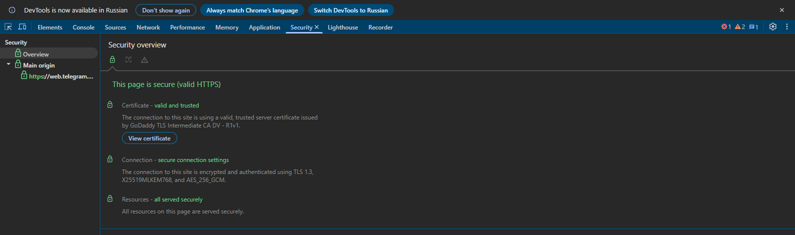
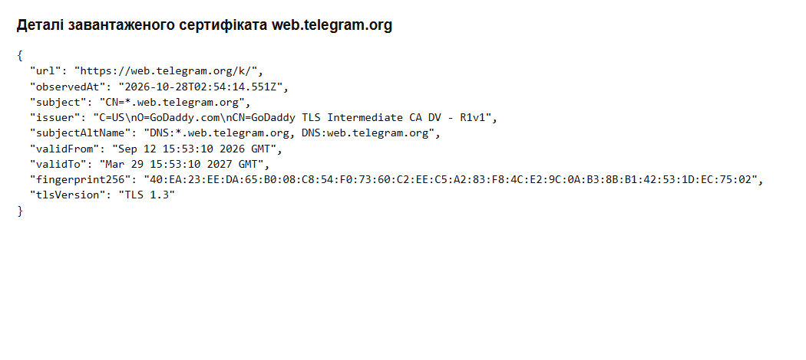

# Самостійна робота №14
## Студент: Матвійчук Роман
## Група: ІПЗ-4/2
## Тема: Мережева безпека: TLS, VPN, типові атаки
## Варіант: 8 (вебмесенджер; ARP-спуфінг)

### 1. Картка сертифіката Telegram Web

Перевірив [Telegram Web](https://web.telegram.org/) у Chrome 28.10.2026. Після переходу відкрилася вебверсія за адресою `https://web.telegram.org/k/`.

| Поле | Фактичне значення |
|---|---|
| Домен | `web.telegram.org`; SAN містить `web.telegram.org` та `*.web.telegram.org` |
| Видавець | GoDaddy TLS Intermediate CA DV - R1v1 |
| Термін дії, UTC | 12.09.2026 15:53:10 — 29.03.2027 15:53:10 |
| Версія TLS цього з'єднання | TLS 1.3 |





Строк дії та видавця взято з реального сертифіката. Версія TLS визначається під час встановлення з'єднання й не є полем самого сертифіката. [Збережені дані перевірки](certificate.json).

### 2. Рукостискання TLS 1.3

1. **Клієнт → сервер: ClientHello.** Браузер пропонує підтримувані версії TLS, криптографічні набори та свою частину обміну ключами `key_share`.
2. **Сервер → клієнт: ServerHello, далі зашифровані повідомлення.** Сервер обирає параметри й надсилає свою `key_share`; сторони обчислюють ключі рукостискання. Далі сервер передає `EncryptedExtensions`, `Certificate`, `CertificateVerify` і `Finished`.
3. **Браузер перевіряє сертифікат і справжність сервера.** Домен має відповідати SAN, поточний час — строку дії, а ланцюжок підписів — вести до довіреного центру. Приклади помилок Chrome: невідповідність домену — `NET::ERR_CERT_COMMON_NAME_INVALID`; прострочення — `NET::ERR_CERT_DATE_INVALID`; недовірений видавець — `NET::ERR_CERT_AUTHORITY_INVALID`. Також перевіряються підпис `CertificateVerify` і повідомлення `Finished`.
4. **Клієнт → сервер: Finished; далі дані застосунку.** Після успішних перевірок браузер надсилає своє `Finished`, і сторони використовують ключі трафіку для захищеного обміну HTTP. Це звичайне повне рукостискання без клієнтського сертифіката й без 0-RTT.

```text
Клієнт                                      Сервер
  |----------- ClientHello ------------------>|
  |<---------- ServerHello -------------------|
  |<-- {EncryptedExtensions, Certificate,     |
  |     CertificateVerify, Finished} ---------|
  |  Перевірка домену, строку й довіри         |
  |----------- {Finished} ------------------->|
  |<======= захищені дані застосунку ========>|
```

Фігурні дужки позначають повідомлення, захищені ключами рукостискання. Джерело: [RFC 8446, §2](https://www.rfc-editor.org/rfc/rfc8446.html#section-2).

### 3. ARP-спуфінг у локальній мережі

Зловмисник надсилає підроблені ARP-повідомлення, які пов'язують IPv4-адресу шлюзу з його MAC-адресою. Через це комп'ютер може передавати йому трафік, а він — пересилати його далі, займаючи позицію посередника. Для незашифрованих даних це порушує **конфіденційність (C)**, а підміна даних — **цілісність (I)**. Перший контрзахід — HTTPS із правильною перевіркою сертифіката: сам ARP-спуфінг не дає змоги прочитати або непомітно змінити такий TLS-трафік. Другий — VPN із перевіркою справжності шлюзу, який захищає трафік до VPN-сервера навіть за наявності посередника в локальній мережі. У керованій мережі додатково можна застосувати Dynamic ARP Inspection зі справжніми прив'язками IP–MAC для блокування підроблених ARP-повідомлень ([опис Cisco](https://www.cisco.com/c/en/us/td/docs/switches/lan/c9000/sec-crypto/fhs-sisf/fhs-and-sisf-configuration-guide/dynamic-arp-inspection.html)).

### 4. Порівняння TLS і VPN

| Критерій | TLS | VPN |
|---|---|---|
| Що шифрується | Дані конкретного з'єднання між клієнтом і сервером, наприклад HTTPS до Telegram Web. | IP-трафік, спрямований у тунель між пристроєм і VPN-шлюзом; у режимі full tunnel — увесь маршрутизований через нього трафік, у split tunnel — вибрані мережі. |
| Типовий сценарій | Захист вебсайту, API чи іншого окремого мережевого з'єднання. | Віддалений доступ до приватної мережі або захист передавання через недовірену локальну мережу. |

```text
Пристрій == зашифрований VPN-тунель ==> VPN-шлюз --> сервер
         <--------- TLS до HTTPS-сервера ---------------->
```

Після VPN-шлюзу трафік уже не захищений саме цим тунелем, тому HTTPS продовжує мати значення. TLS і VPN можуть працювати одночасно. 

#### Контрольні запитання

1. **Що перевіряє браузер:** відповідність домену, строк дії, підписи й довірений ланцюжок сертифікатів.
2. **Помилка домену:** у Chrome — `NET::ERR_CERT_COMMON_NAME_INVALID`.
3. **Обсяг захисту:** TLS захищає окреме з'єднання, а VPN — трафік, маршрутизований у тунель до шлюзу.

## Висновок

На прикладі Telegram Web перевірив сертифікат і TLS 1.3. ARP-спуфінг може змінити шлях трафіку, але для читання правильно захищеного HTTPS цього недостатньо. TLS захищає зв'язок із сервером, а VPN — визначений маршрут до свого шлюзу.
