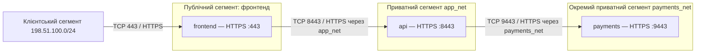

# Самостійна робота №15
## Студент: Матвійчук Роман
## Група: ІПЗ-4/2
## Тема: Хмарні та контейнерні мережі, моніторинг
## Варіант: 8 (банкінг: фронтенд, API, сервіс платежів)

### 1. Мережева схема застосунку

Для навчальної схеми обрав три контейнери на одному Docker-хості. Публічно доступний лише фронтенд; API працює у приватному сегменті, а сервіс платежів — в окремому ізольованому сегменті. Порти нижче є проєктними налаштуваннями; для клієнтського сегмента навчального стенда обрав документаційний діапазон `198.51.100.0/24`.

Фронтенд підключений до своєї зовнішньої bridge-мережі та `app_net`; API — до `app_net` і `payments_net`; `payments` — лише до `payments_net`. Мережі `app_net` і `payments_net` створюю з `internal: true`; назовні публікую тільки `443:443` фронтенду. Портів API і платежів на Docker-хості не публікую, IP-пересилання та маршрутизацію між мережевими інтерфейсами контейнера API не вмикаю. Тому фронтенд не має прямого мережевого доступу до `payments`, а взаємодія відбувається через запити до API.

### 2. Режим мережі контейнерів і пошук за іменем

Обираю **користувацькі bridge-мережі**, оскільки в цій схемі всі три контейнери працюють на одному хості. Окремі мережі дозволяють відділити сервіс платежів і підключити до його сегмента лише API. Вбудований DNS Docker дає змогу фронтенду звертатися до `https://api:8443`, а API — до `https://payments:9443` за іменами сервісів у спільній мережі. Режим **host** не підходить, бо контейнери ділили б мережевий простір хоста й потрібна ізоляція сегментів зникла б. **Overlay** потрібний для зв'язку між різними Docker-хостами, тому для цього розгортання він зайвий.

### 3. Групи безпеки

| Сервіс | Дозволений вхідний порт | Дозволене джерело |
|---|---|---|
| frontend | TCP 443 | Лише клієнтська підмережа стенда `198.51.100.0/24` |
| api | TCP 8443 | Лише контейнер frontend у `app_net` |
| payments | TCP 9443 | Лише контейнер api у `payments_net` |

Для всіх інших нових вхідних з'єднань діє заборона; відповіді в уже дозволених з'єднаннях пропускаються. Джерело визначаю належністю до конкретного сервісу й мережі, а не лише наявністю приватної IP-адреси. На звичайному Docker-хості таблицю потрібно втілити правилами фаєрвола, які враховують Docker bridge; у хмарі — відповідними групами безпеки. Саме налаштування `expose` не є фаєрволом, а контейнерам у спільній bridge-мережі Docker за замовчуванням доступні порти одне одного.

### 4. Метрики й діагностика недоступності

| Метрика | Що перевіряю |
|---|---|
| Затримка відповіді | p50 і p95 окремо для фронтенду, API та сервісу платежів. |
| Частка помилок | Частку HTTP 5xx, мережевих помилок і тайм-аутів за однаковий проміжок часу. |
| Healthcheck | Стан живучості й готовності кожного сервісу; готовність API також враховує доступ до платежів. |
| Використання ресурсів | CPU, RAM, обмеження контейнерів, кількість перезапусків і OOM-подій. |
| Навантаження на з'єднання | Кількість запитів за секунду та активних з'єднань, щоб помітити перевантаження. |

Порядок діагностики:

1. **Перевірити ім'я й порт із потрібного місця.** З клієнтського сегмента — адресу банкінгу й TCP 443; із фронтенду — DNS `api` та TCP 8443; з API — DNS `payments` та TCP 9443. Це швидко показує, на якій ділянці немає зв'язку; перевірка лише з хоста не доводить доступність із контейнера.
2. **Перевірити готовність і стан контейнерів.** Переглянути healthcheck, TLS-з'єднання, коди відповідей, тайм-аути, перезапуски та CPU/RAM. Порівняти час появи помилок із метриками, щоб відрізнити збій мережі від перевантаження сервісу.
3. **Перевірити причину глибше.** Зіставити журнали фронтенду, API й платежів за ідентифікатором запиту, перевірити приєднання до мереж, маршрути та правила фаєрвола. За потреби зняти мережевий трасувальний запис на проблемній ділянці й перевірити DNS, TCP або TLS-обмін.

#### Контрольні запитання

1. **Чому не відкривати базу чи чергу назовні:** до них має звертатися застосунок; зайвий публічний порт створює непотрібний шлях прямого доступу.
2. **Коли підходить host:** коли свідомо потрібний спільний мережевий простір хоста й мінімальні мережеві накладні витрати; це рідко виправдовує втрату ізоляції та конфлікти портів.
3. **Перша перевірка:** резолв імені й доступність порту з того сервісу або сегмента, де виникла проблема.

## Висновок

Побудував схему банкінгу з трьох сервісів і відокремив платежі від публічного фронтенду. API є єдиним сервісом застосунку, який має доступ до сегмента платежів. Перевірка DNS, портів, стану контейнерів і журналів дає послідовний спосіб знайти причину недоступності.
