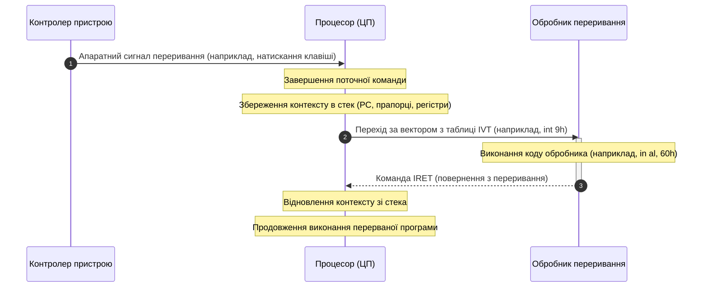

# Домашнє завдання з лекції №10
## Студент: Матвійчук Роман
## Група: ІПЗ-4/2

### 1. Схема послідовності обробки переривання:

### 2.
* а) Натискання клавіші на клавіатурі: Апаратне переривання (асинхронний зовнішній сигнал від контролера).
* б) Спроба ділення числа на нуль: Виняток (exception / fault) (помилка виконання арифметичної команди).
* в) Зупинка програми на точці зупинки в дебагері: Пастка (trap) (навмисне програмне переривання/breakpoint).

### 3. Пояснення щодо довгого читання з диска:

Читання з накопичувача вимагає мільйонів тактів очікування. Якщо виконувати його всередині обробника, процесор заблокує інші переривання, через що система втратить нові події від клавіатури, таймера чи мережі.