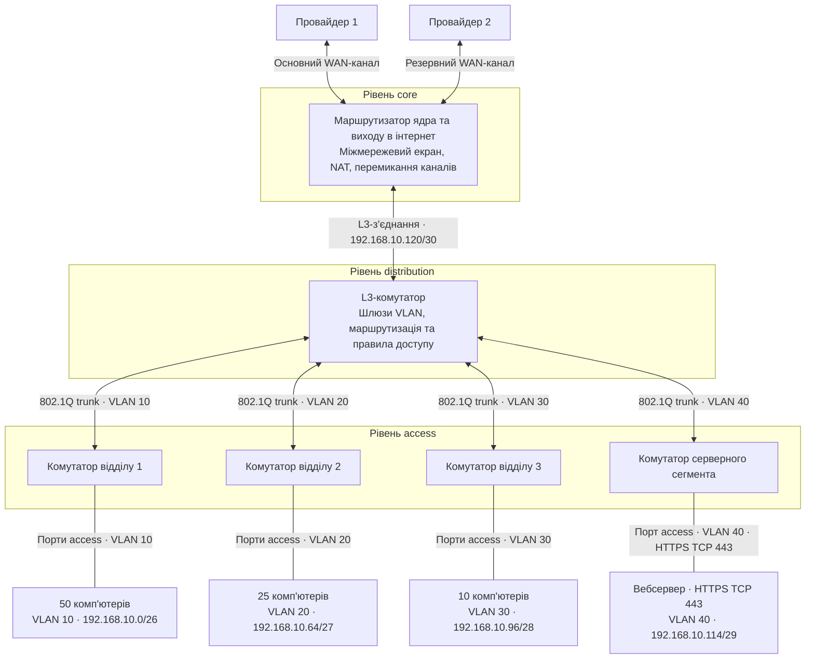

# Домашнє завдання з лекції №20
## Студент: Матвійчук Роман
## Група: ІПЗ-4/2

### 1. Логічна схема мережі малого офісу

#### 1.1. Вихідні дані та вимоги

Для навчального проєкту використовую погоджений приклад: **192.168.10.0/24**, три відділи на **50, 25 і 10 комп'ютерів**. Це обрані дані прикладу, оскільки в лекції конкретні кількості й адресний блок не задано.

Кожен відділ має окремий VLAN. Вебсервер розміщую в окремому серверному сегменті **DMZ**, а доступ до інтернету забезпечую двома каналами: основним і резервним. Під час розрахунку адрес для відділів враховую також адресу шлюзу.

#### 1.2. Схема мережі

#### 1.3. Розподіл адрес методом VLSM

Спочатку виділяю найбільшу підмережу, потім менші. Для звичайної IPv4-підмережі кількість доступних адрес вузлів обчислюється так:

**2ʰ − 2 ≥ N**, де h — кількість бітів вузла, а N — потрібна кількість адрес. Префікс дорівнює **32 − h**.

| Сегмент | Потрібно адрес | Розрахунок | Обраний префікс | Маска |
|---|---:|---|---|---|
| Відділ 1 | 50 ПК + 1 шлюз = 51 | 2⁶ − 2 = 62 ≥ 51 | /26 | 255.255.255.192 |
| Відділ 2 | 25 ПК + 1 шлюз = 26 | 2⁵ − 2 = 30 ≥ 26 | /27 | 255.255.255.224 |
| Відділ 3 | 10 ПК + 1 шлюз = 11 | 2⁴ − 2 = 14 ≥ 11 | /28 | 255.255.255.240 |
| DMZ | 1 сервер + 1 шлюз = 2 | 2³ − 2 = 6; є запас адрес | /29 | 255.255.255.248 |
| З'єднання core–distribution | 2 інтерфейси | 2² − 2 = 2 | /30 | 255.255.255.252 |

Для DMZ обрав /29 із запасом на додаткові сервери. Підмережі /30 вистачило б лише на поточний сервер і шлюз.

| Сегмент | Адреса мережі | Доступні адреси вузлів | Broadcast | Шлюз / інтерфейси |
|---|---|---|---|---|
| VLAN 10 | `192.168.10.0/26` | 192.168.10.1–192.168.10.62 | 192.168.10.63 | Шлюз 192.168.10.1 |
| VLAN 20 | `192.168.10.64/27` | 192.168.10.65–192.168.10.94 | 192.168.10.95 | Шлюз 192.168.10.65 |
| VLAN 30 | `192.168.10.96/28` | 192.168.10.97–192.168.10.110 | 192.168.10.111 | Шлюз 192.168.10.97 |
| VLAN 40, DMZ | `192.168.10.112/29` | 192.168.10.113–192.168.10.118 | 192.168.10.119 | Шлюз 192.168.10.113; сервер 192.168.10.114 |
| Core–distribution | `192.168.10.120/30` | 192.168.10.121–192.168.10.122 | 192.168.10.123 | Distribution: .121; core: .122 |

Підмережі не перетинаються й повністю входять у початковий блок /24. Виділено **64 + 32 + 16 + 8 + 4 = 124 адреси**. У резерві залишаються **192.168.10.124/30** і **192.168.10.128/25**, разом **132 адреси**.

#### 1.4. Розподіл пристроїв за ієрархічними рівнями

| Рівень | Пристрої в схемі | Призначення |
|---|---|---|
| **Access** | Три комутатори відділів і комутатор DMZ | Підключають комп'ютери та сервер; кінцеві порти належать потрібним VLAN. |
| **Distribution** | L3-комутатор | Об'єднує сегменти доступу, містить шлюзи VLAN, маршрутизує трафік між ними й застосовує правила доступу. |
| **Core** | Маршрутизатор ядра, який у малому офісі також виконує роль прикордонного пристрою | Передає трафік між distribution та зовнішніми каналами; забезпечує вихід через основного або резервного провайдера. |

На L3-комутаторі маршрут за замовчуванням спрямовую на **192.168.10.122**. На маршрутизаторі ядра маршрут до офісного блоку **192.168.10.0/24** спрямовую на **192.168.10.121**. Це забезпечує шлях як назовні, так і назад до VLAN.

#### 1.5. Резервування каналу та правила доступу

Основний WAN-канал має пріоритет, а резервний використовується після виявлення недоступності основного. Для автоматичного перемикання потрібна перевірка доступності зовнішнього вузла та зміна активного маршруту за замовчуванням. Самої наявності другого кабелю недостатньо.

Доступ між відділами обмежую правилами на рівні distribution. Для опублікованого вебсервера міжмережевий екран дозволяє вхідний **TCP 443** і, за використання приватної адреси за NAT, переспрямовує його на **192.168.10.114:443**. Прямі вхідні з'єднання з інтернету до комп'ютерів відділів заборонені.

### 2. Порівняння режимів мереж контейнерів

| Режим | Рівень ізоляції | Швидкість | Типовий випадок використання |
|---|---|---|---|
| **Bridge** | Контейнер має власний мережевий простір та адресу в мережі мосту; доступ між мережами контролюється окремо. | Є накладні витрати на віртуальний міст і, за використання, NAT. | Кілька сервісів на одному хості, наприклад API й база даних у користувацькій Docker-мережі. |
| **Host** | Контейнер використовує мережевий простір хоста; окремої мережевої ізоляції немає. | Найменші накладні витрати серед цих режимів, бо немає окремого контейнерного мосту. | Сервіс, якому потрібен прямий доступ до мережі хоста або мінімальні мережеві накладні витрати. |
| **Overlay** | Ізольована логічна мережа об'єднує контейнери на різних фізичних хостах. | Інкапсуляція й передавання між хостами додають накладні витрати; результат залежить від фізичної мережі. | Розподілений контейнерний застосунок на кількох вузлах кластера. |

У користувацькій bridge-мережі сервіси можуть знаходити один одного за іменами через вбудований DNS. У host-режимі такий механізм Docker-мережі не надається: потрібні адреса й порт хоста або окрема служба виявлення сервісів.
