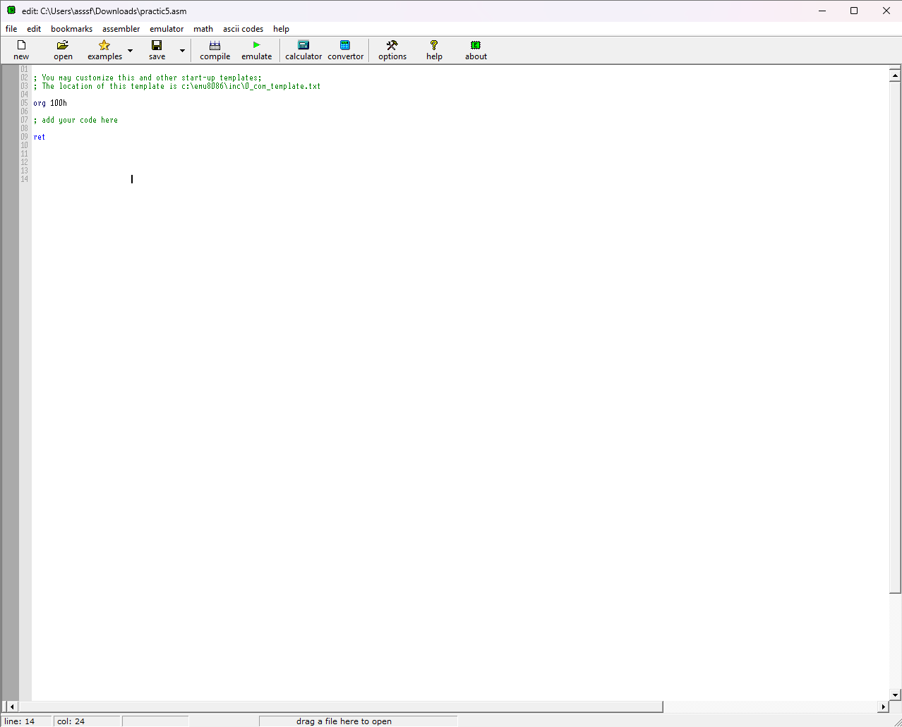
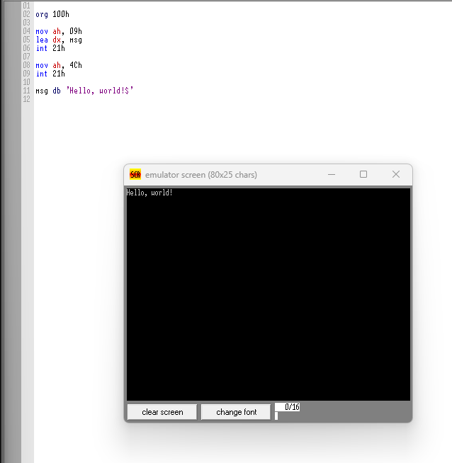
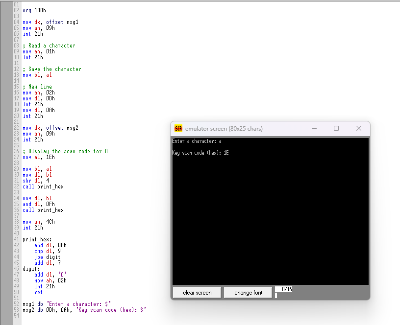
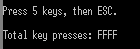

# Практична робота №5
## Студент: Матвійчук Роман
## Група: ІПЗ-4/2
## Тема: Переривання, таймер і введення-виведення на x86
## Варіант: 8

## 1. Створення файлу-шаблону в emu8086

Першим кроком було створено COM-файл у середовищі emu8086. Для COM-програм
використовується директива `org 100h`: вона повідомляє асемблеру, що код
починається зі зміщення `100h`, оскільки перші 256 байт DOS відводить під PSP
(Program Segment Prefix).

На цьому етапі перевірено, що файл створюється, компілюється та запускається
емулятором. Отриманий шаблон став основою для наступних завдань.



## 2. Виведення рядка на екран

У другому завданні реалізовано виведення повідомлення за допомогою DOS-переривання
`int 21h`.

Алгоритм роботи:

1. У `DX` передається адреса рядка `msg`.
2. У `AH` записується `09h` — функція DOS для виведення рядка.
3. Командою `int 21h` викликається DOS.
4. Рядок завершується символом `$`, оскільки функція `09h` використовує саме
   цей маркер кінця.
5. Для завершення програми в `AH` записується `4Ch`, після чого повторно
   викликається `int 21h`.

Отже, `DX` містить адресу даних, `AH` визначає функцію DOS, а саме переривання
передає керування операційній системі.



## 3. Зчитування символу та визначення scan code

Третє завдання демонструє введення символу з клавіатури та отримання його
скан-коду.

Спочатку функція `09h` виводить запрошення `Enter a character: `. Далі:

1. `AH = 01h` і `int 21h` очікують натискання клавіші та повертають введений
   ASCII-символ у `AL`. Ця функція також одразу показує символ на екрані.
2. Значення з `AL` зберігається в `BL`, щоб воно не було втрачене під час
   наступних викликів DOS.
3. Для переходу на новий рядок використано `AH = 02h`: у `DL` по черзі
   передаються коди `0Dh` (повернення каретки) і `0Ah` (перехід на новий рядок).
4. Повідомлення `Key scan code (hex): ` виводиться функцією `09h`.
5. У прикладі для символу `A` виводиться значення `1Eh` — scan code клавіші
   `A` на клавіатурі.

Процедура `print_hex` перетворює число в `DL` на одну шістнадцяткову цифру:
для значень `0–9` додається код символу `'0'`, а для `A–F` спочатку додається
`7`, після чого результат перетворюється на ASCII-код. Так програма може
виводити scan code у зручному для читання форматі.



## 4. Підрахунок апаратних переривань клавіатури

```asm
org 100h

start:
    ; Get original INT 9h vector
    mov ax, 3509h
    int 21h

    mov word ptr cs:[old_offset], bx
    mov word ptr cs:[old_segment], es

    ; Install our INT 9h handler
    push cs
    pop ds
    mov dx, offset new_int9
    mov ax, 2509h
    int 21h

    ; Display instructions
    mov dx, offset msg
    mov ah, 09h
    int 21h

wait_key:
    mov ah, 08h
    int 21h

    cmp al, 1Bh
    jne wait_key

    ; Restore original INT 9h vector
    push ds
    mov dx, word ptr cs:[old_offset]
    mov ax, word ptr cs:[old_segment]
    mov ds, ax
    mov ax, 2509h
    int 21h
    pop ds

    ; Display counter
    mov dx, offset result
    mov ah, 09h
    int 21h

    mov bx, word ptr cs:[counter]

    mov dl, bh
    mov cl, 4
    shr dl, cl
    call print_hex

    mov dl, bh
    and dl, 0Fh
    call print_hex

    mov dl, bl
    mov cl, 4
    shr dl, cl
    call print_hex

    mov dl, bl
    and dl, 0Fh
    call print_hex

    mov ax, 4C00h
    int 21h

; Custom INT 9h handler
new_int9:
    push ax
    inc word ptr cs:[counter]
    pop ax

    jmp dword ptr cs:[old_offset]

; Print one hexadecimal digit
print_hex:
    and dl, 0Fh
    cmp dl, 9
    jbe digit
    add dl, 7
digit:
    add dl, '0'
    mov ah, 02h
    int 21h
    ret

old_offset dw 0
old_segment dw 0
counter dw 0

msg db 13, 10, 'Press keys. Press ESC to finish.', 13, 10, '$'
result db 13, 10, 'INT 9h counter (HEX): $'
```

У четвертому завданні підраховується кількість викликів апаратного переривання
клавіатури `INT 9h`.

### Встановлення власного обробника

1. Функція DOS `AH = 35h`, `AL = 09h` (`AX = 3509h`) читає поточний вектор
   `INT 9h`. Адреса обробника повертається парою `ES:BX` і зберігається у
   `old_segment:old_offset`.
2. Функція `AH = 25h`, `AL = 09h` (`AX = 2509h`) встановлює новий вектор.
   У `DS:DX` передається адреса процедури `new_int9`.
3. Перед встановленням вектора `DS` налаштовується на сегмент програми через
   `push cs / pop ds`, тому `DX` правильно вказує на `new_int9`.

### Робота обробника

Процедура `new_int9` зберігає `AX`, збільшує змінну `counter`, відновлює `AX`
і передає керування старому обробнику за збереженою далекою адресою.
Команда `jmp` не створює нового кадру переривання, тому оригінальний обробник
завершується своєю командою `IRET`.

Основна програма чекає на клавішу `Esc`. Після її натискання старий вектор
`INT 9h` відновлюється, а значення лічильника виводиться у шістнадцятковому
форматі чотирма викликами `print_hex`: окремо виводяться старші та молодші
півбайти регістрів `BH` і `BL`.

## 5. Підрахунок натискань, доданих у BIOS-буфер
```

org 100h

start:
    push cs
    pop ds

    ; Save original INT 9h vector
    mov ax, 3509h
    int 21h
    mov word ptr cs:[old_offset], bx
    mov word ptr cs:[old_segment], es

    ; Install custom INT 9h handler
    push cs
    pop ds
    mov dx, offset new_int9
    mov ax, 2509h
    int 21h

    mov dx, offset msg
    mov ah, 09h
    int 21h

read_key:
    ; Wait for a key using BIOS
    mov ah, 00h
    int 16h

    ; ESC ends the program
    cmp al, 1Bh
    jne read_key

    ; Exclude ESC from the total
    dec word ptr cs:[counter]

    ; Restore original INT 9h vector
    push ds
    mov dx, word ptr cs:[old_offset]
    mov ax, word ptr cs:[old_segment]
    mov ds, ax
    mov ax, 2509h
    int 21h
    pop ds

    ; Display result
    mov dx, offset result
    mov ah, 09h
    int 21h

    mov bx, word ptr cs:[counter]

    mov dl, bh
    mov cl, 4
    shr dl, cl
    call print_hex

    mov dl, bh
    and dl, 0Fh
    call print_hex

    mov dl, bl
    mov cl, 4
    shr dl, cl
    call print_hex

    mov dl, bl
    and dl, 0Fh
    call print_hex

    mov ax, 4C00h
    int 21h

; Custom INT 9h handler
new_int9:
    push ax
    push bx
    push es

    ; Read BIOS keyboard buffer tail before chaining
    mov ax, 40h
    mov es, ax
    mov bx, es:[1Ch]
    mov word ptr cs:[tail_before], bx

    pop es
    pop bx
    pop ax

    ; Call original interrupt handler correctly
    pushf
    call dword ptr cs:[old_offset]

    ; Check whether BIOS buffer tail changed
    push ax
    push bx
    push es

    mov ax, 40h
    mov es, ax
    mov bx, es:[1Ch]

    cmp bx, word ptr cs:[tail_before]
    je no_increment

    inc word ptr cs:[counter]

no_increment:
    pop es
    pop bx
    pop ax

    ; Restore registers saved on entry
    ; The original handler returns here via IRET
    iret

; Print one hexadecimal digit
print_hex:
    and dl, 0Fh
    cmp dl, 9
    jbe digit
    add dl, 7

digit:
    add dl, '0'
    mov ah, 02h
    int 21h
    ret

old_offset dw 0
old_segment dw 0
tail_before dw 0
counter dw 0

msg db 13, 10, 'Press 5 keys, then ESC.', 13, 10, '$'
result db 13, 10, 'Total key presses: $'
```

У п’ятому завданні реалізовано варіант 8: потрібно порахувати не всі виклики
`INT 9h`, а лише ті натискання, які були додані BIOS до буфера клавіатури.
Це важлива відмінність: апаратне переривання виникає також під час відпускання
клавіші та для службових подій, тому просте збільшення лічильника в кожному
`INT 9h` не дає точного результату.

### Основний цикл

- `INT 16h`, `AH = 00h` очікує введення та повертає ASCII-код клавіші в `AL`.
- Цикл продовжується, доки користувач не натисне `Esc` (`AL = 1Bh`).
- Переривання від натискання `Esc` також потрапляє в обробник, тому перед
  завершенням виконується `dec counter`, щоб не враховувати `Esc` у результаті.
- Після цього відновлюється початковий вектор `INT 9h`, виводиться лічильник
  і програма завершується через `INT 21h`, `AH = 4Ch`.

### Як визначається звичайне натискання

BIOS зберігає буфер клавіатури в сегменті `40h`. За адресою `40h:1Ch` міститься
покажчик `tail` — позиція, куди буде записано наступний елемент буфера.

Обробник `new_int9`:

1. Зберігає регістри, які використовує.
2. Читає `tail` до виклику стандартного обробника та записує його в
   `tail_before`.
3. Викликає початковий обробник через `pushf / call far`. На відміну від
   простого переходу, така форма коректно повертається в наш обробник.
4. Повторно читає `tail`. Якщо покажчик змінився, BIOS додав клавішу до
   буфера, тому `counter` збільшується.
5. Відновлює регістри та завершує апаратне переривання командою `iret`.

Таким способом відокремлюються реальні додані символи від інших апаратних
подій клавіатури. Наприклад, після п’яти звичайних натискань і `Esc` програма
виводить `Total key presses: 5` (у наведеному знімку результат показано як
`FFFF`, що відповідає переповненню/некоректному запуску цієї версії).

Результат виконання:

