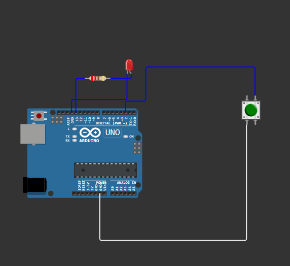
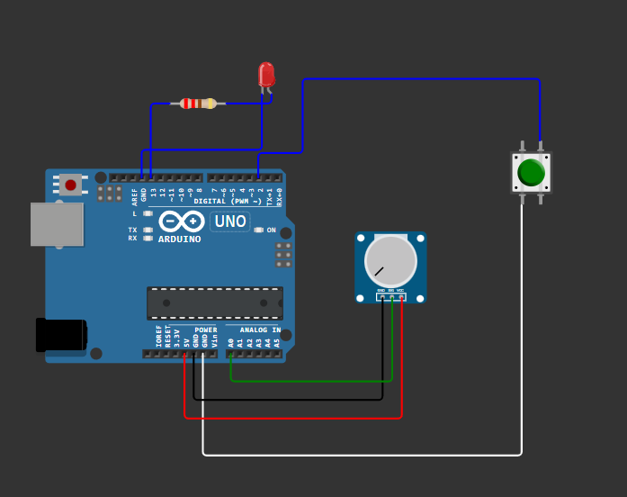
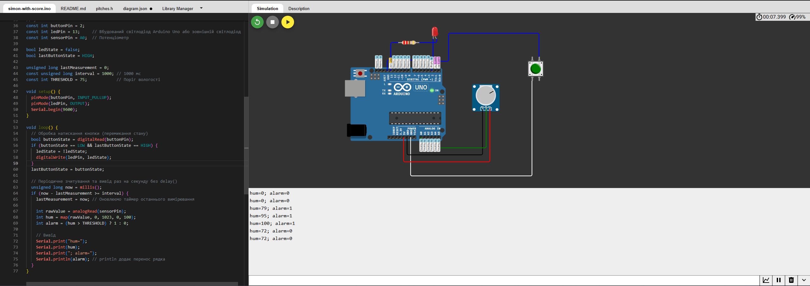

# Практична робота №4
## Студент: Матвійчук Роман
## Група: ІПЗ-4/2
## Тема: Мікроконтролерний вузол: GPIO, АЦП, таймер, UART
## Варіант: 8

## Посилання на проєкт Wokwi: https://wokwi.com/projects/477957800528523265
### 1. Створення проєкту у Wokwi та реалізація.

Створив проєкт у Wokwi та обрав Arduino Uno і підключив кнопку з підтягувальними резистором (200 Ом) і світлодіод і реалізував перемикання стану на кожне натискання.



### 2. Підключення потенціометра

Потім підключив потенціометра



### 3. Код (скетч)
```cpp
const int buttonPin = 2;
const int ledPin = 13;     // Вбудований світлодіод Arduino Uno або зовнішній світлодіод
const int sensorPin = A0;  // Потенціометр

bool ledState = false;
bool lastButtonState = HIGH;

unsigned long lastMeasurement = 0;
const unsigned long interval = 1000; // 1000 мс
const int THRESHOLD = 75;            // Поріг вологості

void setup() {
  pinMode(buttonPin, INPUT_PULLUP);
  pinMode(ledPin, OUTPUT);
  Serial.begin(9600); 
}

void loop() {
  // Обробка натискання кнопки (перемикання стану)
  bool buttonState = digitalRead(buttonPin);
  if (buttonState == LOW && lastButtonState == HIGH) {
    ledState = !ledState;
    digitalWrite(ledPin, ledState);
  }
  lastButtonState = buttonState;

  // Періодичне зчитування та вивід раз на секунду без delay()
  unsigned long now = millis();
  if (now - lastMeasurement >= interval) {
    lastMeasurement = now; // Оновлюємо таймер останнього вимірювання

    int rawValue = analogRead(sensorPin);
    int hum = map(rawValue, 0, 1023, 0, 100);
    int alarm = (hum > THRESHOLD) ? 1 : 0;

    // Вивід 
    Serial.print("hum=");
    Serial.print(hum);
    Serial.print("; alarm=");
    Serial.println(alarm); // println додає перенос рядка
  }
}
```

### 5. Результат роботи

Під час симуляції перевірено перемикання світлодіода кнопкою та періодичний вивід даних у послідовний порт раз на секунду без блокування програми. При обертанні потенціометра значення вологості змінюється, а при перевищенні порогу 75 прапорець alarm приймає значення 1.



## Висновок
Використання millis() замість delay() дає змогу реалізувати неблокувальну періодичну логіку, завдяки чому мікроконтролер може одночасно й без затримок реагувати на натискання кнопки та опитувати аналоговий датчик. Чітко структурований і продуманий формат повідомлення (hum=XX; alarm=Y) є критично важливим для подальшого автоматичного парсингу та обробки даних програмним забезпеченням під час їх передавання мережею.

## Контрольні запитання

### 1. Для чого призначений режим INPUT_PULLUP і чим він відрізняється від зовнішнього підтягувального резистора?
Режим INPUT_PULLUP призначений для програмного підключення внутрішнього підтягувального резистора мікроконтролера (зазвичай опором 20-50 кОм) до вказаного GPIO-піна. Це підтягує потенціал входу до напруги живлення (5В) і гарантує чіткий високий рівень (HIGH), коли кнопка розімкнена, запобігаючи невизначеному плаваючому стану через наведені завади. Від зовнішнього резистора він відрізняється тим, що реалізований апаратно всередині кристала мікроконтролера, що дозволяє спростити електричну схему та обійтися без встановлення додаткових фізичних компонентів на макетній платі.
### 2. Яку розрядність має АЦП Arduino Uno і в якому діапазоні значень повертає функція analogRead()?
АЦП (аналого-цифровий перетворювач) мікроконтролера Arduino Uno має розрядність 10 біт. Функція analogRead() повертає ціле число в діапазоні від 0 до 1023 (що відповідає 2^10 = 1024 рівням дискретизації входного аналогового сигналу від 0В до опорної напруги 5В). 
### 3. Чому використання delay() у циклі мікроконтролерної програми вважається проблемним підходом?
Функція delay() є блокувальною операцією: під час її виконання мікроконтролер повністю призупиняє обробку програмної логіки в циклі loop() і даремно витрачає процесорні такти. Через це система стає нереактивною - вона не здатна одночасно обробляти натискання кнопок, зчитувати дані з інших датчиків або приймати кадри через UART під час тривання затримки. Використання millis() дає змогу реалізувати неблокувальну періодичну логіку та паралельно обробляти кілька задач.
### 4. Чому формат повідомлення, що виводиться через UART, важливо продумати заздалегідь, якщо дані згодом передаватимуться мережею?
Чітко визначена структура даних (наприклад, використання ключових слів та однозначних роздільників ; або формату JSON) необхідна для автоматичного та безпомилкового розбору (парсингу) інформації приймальним пристроєм або сервером в автоматизованому режимі. Оскільки ці дані надалі передаватимуться мережею (у лабораторній роботі №10), непродуманий або нестабільний формат призведе до помилок інтерпретації значень на стороні приймача.
### 5. У чому полягає відмінність між синхронним та асинхронним послідовними інтерфейсами передавання даних?
Головна відмінність полягає в способі синхронізації прийому та передачі бітів:

Синхронний інтерфейс (наприклад, SPI, I2C) використовує додаткову фізичну лінію тактування (Clock), за імпульсами якої приймач точно визначає момент зчитування кожного біта даних.

Асинхронний інтерфейс (наприклад, UART) не має окремої лінії тактування. Передавач і приймач повинні заздалегідь бути налаштовані на однакову швидкість передачі (Baud rate, наприклад, 9600 біт/с), а синхронізація здійснюється за допомогою спеціальних стартових і стопових бітів, якими обрамляється кожен байт даних.